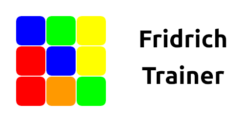
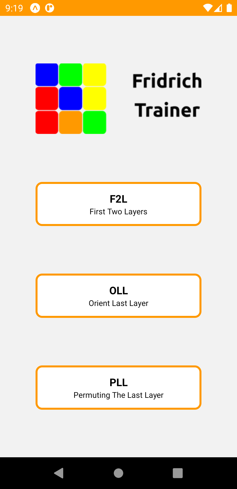
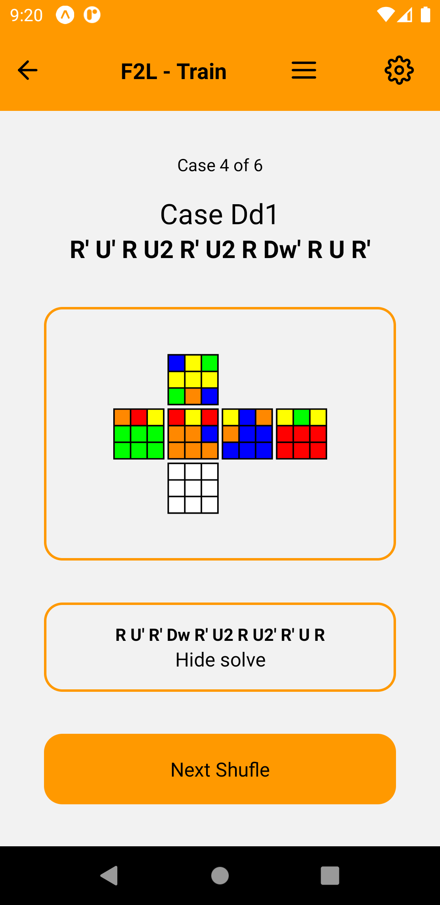
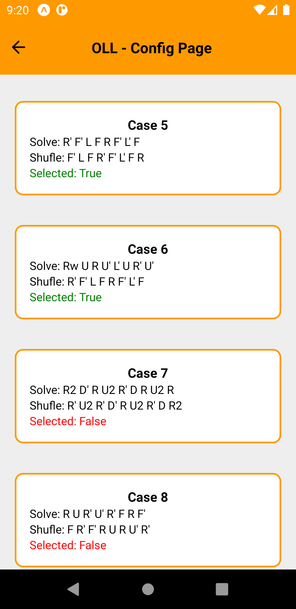
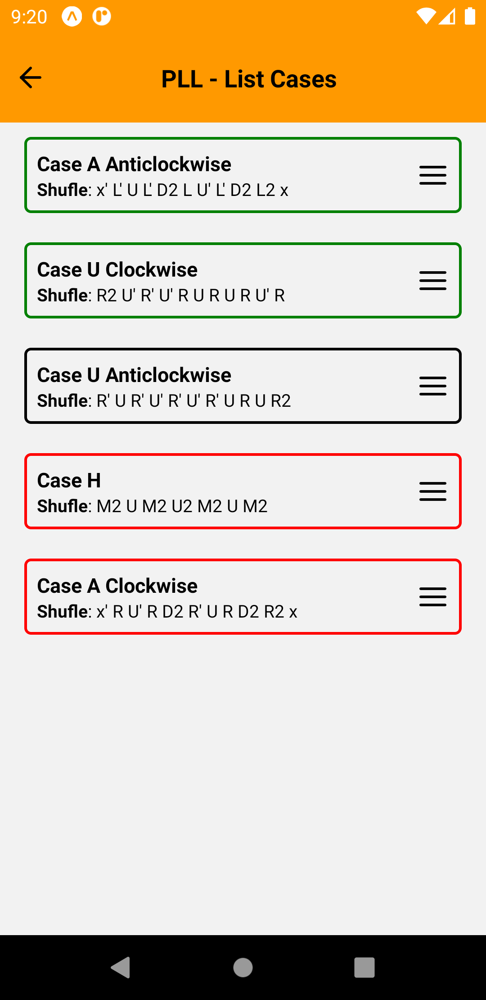
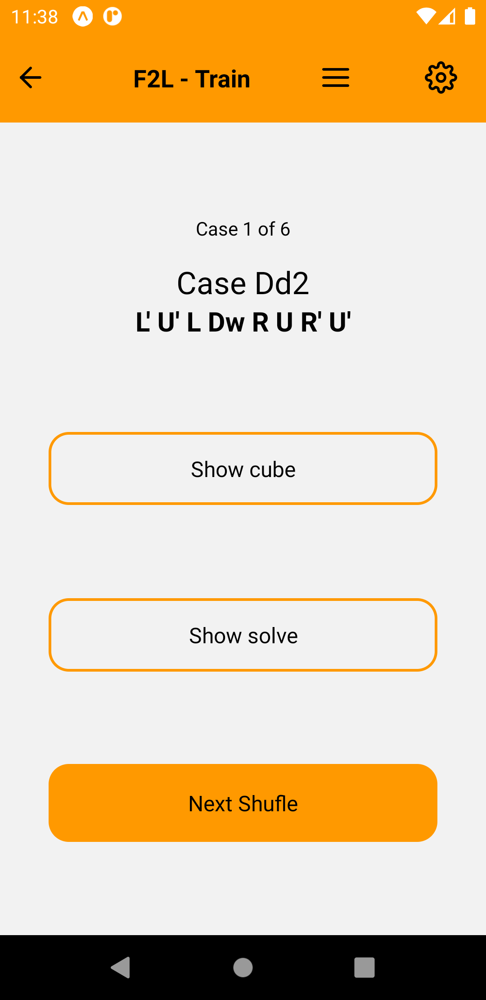
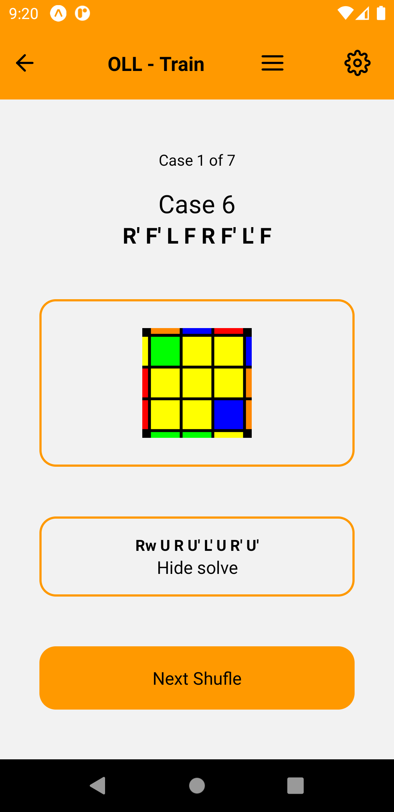
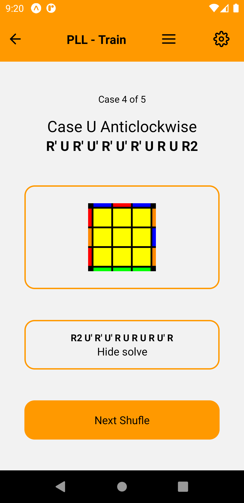

<!-- PROJECT LOGO -->
<br />
<div align="center">
  <a href="https://github.com/darguima/FridrichTrainer">
    
  </a>

  <h3 align="center">Fridrich Trainer</h3>

  <p align="center">
    App to practice the most famous method to solve the Rubik's Cube - Fridrich - since the F2L to the OLL and the PLL. All in one simple and intuitive application. 
    <br />
    <br />
    <a href="#️-download--installation">Download Project</a>
    &middot;
    <a href="#-getting-started-with-development">Start Developing</a>
  </p>

<h4 align="center">
⭐ Don't forget to Starring ⭐
</h4>

  <div align="center">

[![TypeScript][TypeScript-badge]][TypeScript-url]
[![ReactNative][ReactNative-badge]][ReactNative-url]

  </div>

  <p align="center">
    
    
    
    
  </p>
</div>


<!-- TABLE OF CONTENTS -->
<details>
  <summary>📋 Table of Contents</summary>

## 📋 Table of Contents

- [About The Project](#-about-the-project)
- [Download & Installation](#️-download--installation)
- [Getting Started with Development](#-getting-started-with-development)
- [Contributing](#-contributing)
- [Developed by](#-developed-by)
</details>


## 🔍 About The Project

### 🎯 The goal

Fridrich Trainer is an app to practice the most famous method to solve the Rubik's Cube. To improve since the F2L to the OLL and the PLL. All in one simple and intuitive application.

### 📱 Pages

<details>
  <summary>Click to expand pages</summary>

#### Landing Page


* Of course we start with the Landing Page
* With a simplistic menu to select one of the three steps of the CFOP.

___

#### Train Page

<div>
	
	
	
	
</div>

* All of the 3 choices have the same layout and workflow, being the only difference the design of the cube simulations
* In the header we 2 buttons to the `Config Page` and to the `List Cases`
* Here are also 2 buttons, one to show the cube simulation and other to show the solve

___

#### Config Page


* Here you can choose what cases do you want that appear on the Train Page.

___

#### List Cases


* To can have a little idea of the cases that we already done and whats we will do
* We also can to reorganize the order of the cases

</details>


## ⬇️ Download & Installation

Download the APK from the project's [Releases](https://github.com/darguima/FridrichTrainer/releases).


## 🚀 Getting Started with Development

To get a local copy up and running follow these simple example steps.

### 1. Prerequisites

Start by installing the following tools:

- [Git](https://git-scm.com/downloads) - Version Control System
- [Node.js](https://nodejs.org/en/download/) - JavaScript runtime
- [Yarn](https://classic.yarnpkg.com/en/docs/install/) - Package manager

- To run the project you will need the `Expo` Environment configured. You can follow the [Expo Official Documentation](https://docs.expo.io/get-started/installation/);

- This project was only tested and developed for Android. So I don't know if it works properly in IOS. Is recommended that you run it in an `Android Phone`;

### 2. Cloning

Now clone the repository to your local machine. You can do this using Git:

```bash
$ git clone git@github.com:darguima/FridrichTrainer.git
# or
$ git clone https://github.com/darguima/FridrichTrainer.git
```

### 3. Dependencies

Install the dependencies:

```bash
$ yarn
```

### 4. Setup

To setup the application you can use

```bash
$ yarn start
```

Finally to run the App you only need to scan the QRCode (you need have the `Expo Go` App on your phone)


## 🤝 Contributing

Contributions are what make the open source community such an amazing place to learn, inspire, and create. Any contributions you make are **greatly appreciated**.

If you have a suggestion that would make this better, please fork the repo and create a pull request. You can also simply open an issue with the tag "enhancement".
Don't forget to give the project a star! Thanks again!

1. Fork the Project
2. Create your Feature Branch (`git checkout -b feature/AmazingFeature`)
3. Commit your Changes (`git commit -m 'Add some AmazingFeature'`)
4. Push to the Branch (`git push origin feature/AmazingFeature`)
5. Open a Pull Request


## 👨‍💻 Developed by

- [Darguima](https://github.com/darguima)


<!-- MARKDOWN LINKS & IMAGES -->
<!-- https://www.markdownguide.org/basic-syntax/#reference-style-links -->
[project-thumbnail]: ./readme/FridrichTrainerLogoHorizontal_500.png

[TypeScript-badge]: https://img.shields.io/badge/TypeScript-3178C6?style=for-the-badge&logo=typescript&logoColor=white
[TypeScript-url]: https://www.typescriptlang.org

[ReactNative-badge]: https://img.shields.io/badge/React%20Native-20232A?style=for-the-badge&logo=react&logoColor=61DAFB
[ReactNative-url]: https://reactnative.dev
